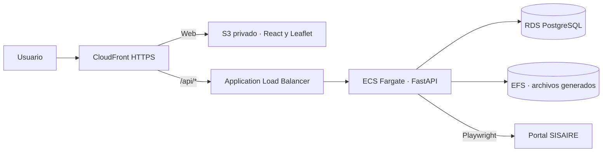

# Air Quality Alerts Bogotá


**Air Quality Alerts Bogotá** es un proyecto de portafolio que transforma reportes de PM2.5 en estados de calidad del aire por estación. Permite cargar mediciones propias o descargar reportes de SISAIRE, seguir el cálculo desde un tablero con mapa interactivo y exportar la memoria que respalda cada resultado.

## Arquitectura



| Capa | Tecnología | Responsabilidad |
|---|---|---|
| Tablero | React, Vite, Tailwind CSS, Leaflet | Carga de archivos, mapa, filtros por estación, historial y descargas |
| API | FastAPI | Ejecuta cálculos en segundo plano y expone su progreso al tablero |
| Ingesta | Playwright, SISAIRE | Descarga y consolida reportes por estación |
| Cálculo | Pandas, catálogo CAR/SISAIRE | Normaliza mediciones, completa coordenadas y evalúa persistencia por estación |
| Persistencia | SQLite o PostgreSQL, archivos locales o EFS | Conserva sesiones, progreso y archivos de cada ejecución |
| Infraestructura | Terraform, S3, CloudFront, ALB, ECS Fargate, ECR, RDS y EFS | Publica la SPA y la API bajo el mismo dominio |

Más detalles en la [arquitectura técnica](docs/architecture.md).

## Ejecutar localmente

Usa Python 3.11 y Node.js 20.19+ de la rama 20, o Node.js 22.12+. La carga manual funciona con los archivos de muestra. El muestreo automático requiere Chromium y acceso al portal SISAIRE.

**API** · Desde la raíz, en una terminal:

```bash
cd backend
python3.11 -m venv .venv
source .venv/bin/activate
python -m pip install -e ".[dev]"
cp .env.example .env
air-quality-alerts api --reload
```

La API queda en `http://localhost:8000`, con Swagger UI en `/docs` y el chequeo de salud en `/api/health`. Para habilitar el muestreo automático, instala el navegador con `playwright install chromium` en el entorno virtual y revisa `JSF_TARGET_URL` en `backend/.env`.

**Web** · Desde la raíz, en otra terminal:

```bash
cd frontend
npm ci
cp .env.example .env
npm run dev
```

Abre `http://localhost:5173` y carga [ejemplo_pm25_bogota.csv](data/samples/ejemplo_pm25_bogota.csv). También puedes generar la memoria por consola con `make calculate-demo` desde la raíz, con el entorno virtual activado. El comando escribe `outputs/memoria_demo.csv` y `outputs/memoria_demo.xlsx`.

Docker Compose ofrece una alternativa para levantar la API con PostgreSQL usando `docker compose up --build`. Ejecuta la web en otra terminal con los mismos comandos anteriores.

### Configuración

| Variable | Uso |
|---|---|
| `JSF_TARGET_URL` | URL del formulario de consultas SISAIRE |
| `DATABASE_URL` | Conexión PostgreSQL. Si queda vacía, el backend usa SQLite en `OUTPUTS_DIR/calculation_jobs.db` |
| `OUTPUTS_DIR`, `DOWNLOADS_DIR` | Directorios de resultados y descargas |
| `ALLOWED_ORIGINS` | Orígenes permitidos por CORS |
| `VITE_API_BASE_URL` | URL de la API en desarrollo. En CloudFront se deja sin definir para usar rutas relativas `/api/*` |

Consulta las plantillas de [backend](backend/.env.example) y [frontend](frontend/.env.example) para ver los valores locales.

## Reglas de cálculo y datos

El motor calcula por estación una media móvil de 24 horas para los reportes horarios. Por defecto requiere 18 mediciones válidas. Cuando SISAIRE entrega un reporte diario preagregado, el motor usa directamente el promedio diario.

| Nivel | PM2.5 (µg/m³) |
|---|---:|
| Normal | Menos de 38 |
| Prevención | Desde 38 hasta menos de 56 |
| Alerta | Desde 56 hasta menos de 151 |
| Emergencia | 151 o más |

Al detectar un nivel candidato, el motor evalúa las 48 lecturas siguientes. Declara el nivel si más del 75 % cae dentro del mismo rango. Para finalizar o recategorizar un nivel vigente, comprueba si más del 75 % de la ventana de seguimiento queda por debajo de su límite inferior.

Para una carga manual en CSV, usa `Estacion`, `Fecha inicial` y `PM2.5`. Puedes incluir `LATITUD` y `LONGITUD`; el motor también busca coordenadas en el catálogo CAR/SISAIRE. La instalación incluye soporte para XLSX; los archivos XLS antiguos requieren instalar `xlrd` en el entorno del backend.

- [Reporte horario](data/samples/reporte_sisaire_pm25_horario.csv) y [reporte diario](data/samples/reporte_sisaire_pm25.csv)
- [Contrato de datos y columnas de salida](docs/data_contract.md)

Cada sesión de la API genera una memoria por lectura en CSV y Excel, un resumen con el último estado por estación y un GeoJSON para el mapa.

## API y sesiones

| Método y ruta | Uso |
|---|---|
| `GET /api/health` | Comprueba la disponibilidad de la API |
| `GET /api/stations/catalog` | Devuelve el catálogo en GeoJSON |
| `GET /api/stations` | Lista las estaciones disponibles |
| `POST /api/jobs/calculate` | Recibe un archivo mediante `multipart/form-data` con el campo `file` |
| `POST /api/jobs/auto-sampling` | Inicia una descarga y cálculo con filtros de estaciones, contaminante y fechas |
| `GET /api/jobs`, `GET /api/jobs/{job_id}` | Consulta el historial y el progreso de una sesión |
| `GET /api/results/{result_id}/{filename}` | Descarga un archivo generado |

Ambas rutas de creación de sesiones devuelven HTTP 202. Los endpoints síncronos equivalentes son `POST /api/calculate` y `POST /api/auto-sampling`. Swagger UI documenta los campos y valores predeterminados.

## CI y despliegue en AWS

El repositorio conserva la configuración de GitHub Actions en un archivo inactivo. El [workflow archivado](.github/workflows/ci.yml.disabled) conserva la configuración de los dos jobs de validación.

| Job | Validación |
|---|---|
| `backend` | Instala el paquete con dependencias de desarrollo y ejecuta Ruff y Pytest en Python 3.11 |
| `frontend` | Instala desde el lockfile con `npm ci` y compila la SPA con Node.js 20 |

Para reproducir las comprobaciones desde la raíz:

```bash
make backend-test
(cd backend && ruff check src tests)
make frontend-build
```

El build web se genera en `frontend/dist/`. Para previsualizarlo, ejecuta `make frontend-preview` con la API local activa y la URL de desarrollo configurada antes de compilar.

El despliegue se ejecuta por separado con Terraform y los scripts del repositorio. Sigue la [guía de infraestructura](infra/terraform/README.md) para configurar `backend_image_uri`, publicar la imagen en ECR y publicar el build web en S3. En AWS, CloudFront entrega la SPA desde un bucket privado mediante OAC y enruta `/api/*` al ALB. ECS obtiene la conexión de PostgreSQL desde Secrets Manager y envía los logs de la API a CloudWatch. Los outputs `frontend_cloudfront_url` y `api_health_url` identifican las URLs para verificar el despliegue.

La imagen Docker se construye desde la raíz con `backend/Dockerfile` e incluye el catálogo de estaciones para el muestreo automático.

## Estructura del repositorio

```text
.
├── .github/workflows/     # Configuración de CI archivada
├── backend/
│   ├── src/air_quality_alerts/
│   │   ├── api/           # FastAPI y sesiones de cálculo
│   │   ├── domain/        # Normalización y reglas PM2.5
│   │   └── ingestion/     # Descargador Playwright
│   └── tests/            # Pruebas del motor
├── frontend/             # SPA con mapa y resultados
├── data/                 # Catálogo y reportes de muestra
├── docs/                 # Arquitectura y contrato de datos
├── infra/terraform/      # Recursos de AWS
├── scripts/              # Publicación en ECR y S3
├── downloads/            # Descargas de SISAIRE
├── outputs/              # Archivos generados
├── docker-compose.yml
└── Makefile
```
